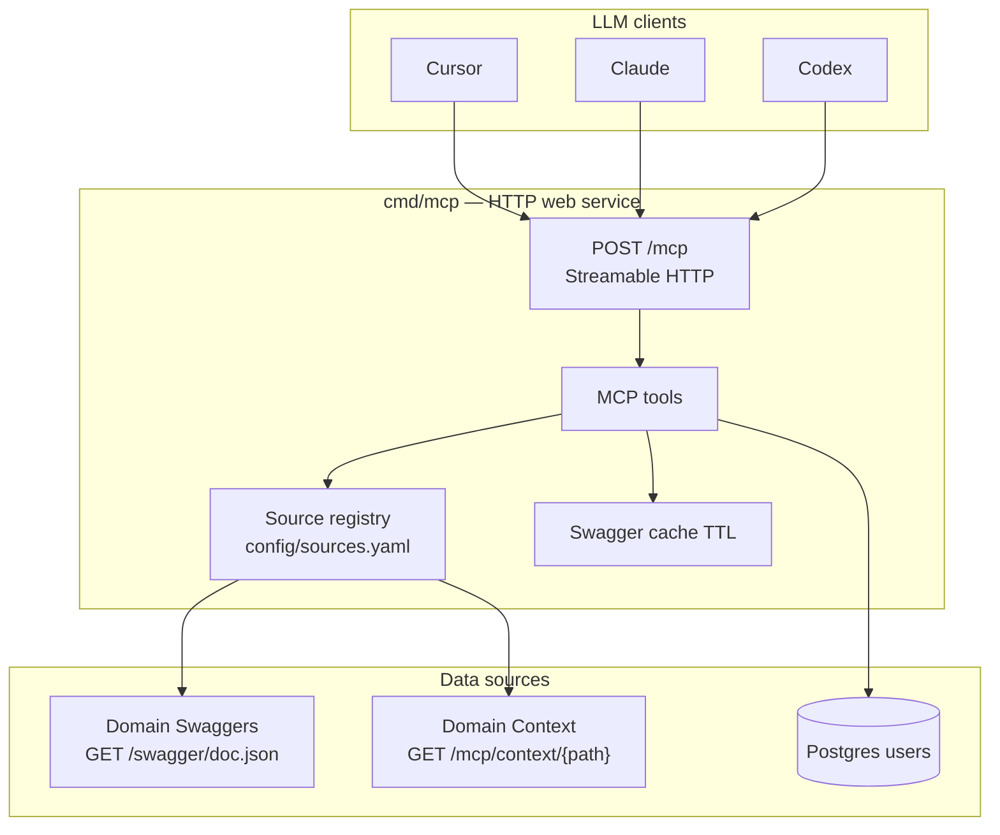

# Project Context AI — Design Document

> **TrioV2-MCP** — Platform MCP server that exposes Trio domain APIs and curated context to external LLM clients (Cursor, Claude Desktop, Codex, etc.).

---

## Overview

Trio MCP is a **deployed HTTP web service** (`cmd/mcp`). It does not embed an LLM. The user's IDE runs the LLM; MCP supplies **tools** so that LLM can:

1. **Discover APIs dynamically** — fetch each domain's OpenAPI/Swagger at runtime (routes stay up to date when services change).
2. **Call live APIs** — devices online, assets, incidents, panel identity, etc.
3. **Read curated context docs** — markdown guides per domain under `context/project_{platform_domain}/`.

**Yes — this is the right architecture.** Domain services own their HTTP routes and Swagger. MCP owns a **source registry** (config file) that points at each domain's swagger URL and context path. Adding a domain does not require new MCP tool code.

Authoritative platform rules live in **`TrioV2-Documents/rules/`** (especially `00-trio-core.mdc`, `10-go-backend.mdc`, `13-docs.mdc`). Platform overview for MCP: [`TrioV2-Documents/Platform/MCP.md`](../TrioV2-Documents/Platform/MCP.md).

---

## Alignment with Trio platform structure

MCP is a **Platform** bounded context — an integration gateway, not a business domain like ID or Device. It follows the same cross-repo and modular-monolith rules as Core.

### Business domain hierarchy

Registry entries map to official Trio domains (from `00-trio-core.mdc`). Use `platform_domain` as the stable key; `name` is the MCP tool identifier for a specific deployable service.

| `platform_domain` | Trio docs folder | Owns | Example MCP `name` |
|-------------------|------------------|------|---------------------|
| `tenant` | `Tenant/` | Organizations, billing scope | (via ID session) |
| `id` | `ID/` | Auth, users, MFA, ACL, panel sessions | `trio-panel` |
| `device` | `Device/` | Enrollment, telemetry, commands | (future) |
| `infra` | Infra / Server Management | Devices, assets, playbooks | `trio-servermanagement` |
| `notification` | `Notification/` | Alerts, channels | (future) |

Context trees use **`context/project_{platform_domain}/`** — e.g. `project_id/`, `project_infra/` — not ad-hoc product codenames.

### Cross-repo boundary

| Rule | MCP behavior |
|------|--------------|
| No Go imports from CoreBackEndApp | MCP calls domain services over **HTTP only** |
| Schema-per-domain Postgres | MCP DB holds **ID/panel** data only (sessions, users); no cross-schema joins to Infra/Device |
| APIs as contracts | Swagger URL + `base_url` in registry; routes discovered at runtime |
| Docs in `TrioV2-Documents/<Domain>/` | Technical `.md` = engineering; MCP `context/` = IDE-oriented summaries that link to authoritative docs |

### Code layout (target — `10-go-backend.mdc`)

When MCP grows inside this repo or merges toward Core patterns, bounded contexts use:

```
internal/domain/mcp/
  entity/          Source, CachedSpec
  repository/      SourceRegistry port implementations
  service/         MCP orchestration (tools)
  delivery/        POST /mcp, JSON-RPC handlers
  adapter/         yaml registry, swagger cache, HTTP API caller
  middleware/      session auth, audit
  wire.go          Wire DI, self-registering routes

internal/domain/id/     panel auth (subset of Trio ID domain — this repo today)
  entity/ repository/ service/ delivery/ adapter/ wire.go
```

**Transitional layout (current repo):** hexagonal folders map 1:1 until refactor:

| Trio target | Current path |
|-------------|--------------|
| `internal/domain/id/service` | `core/auth/usecases/` |
| `internal/domain/id/repository` | `core/auth/ports/` + `adapters/auth/persistence/` |
| `internal/domain/id/delivery` | `internal/app/router.go`, `internal/auth/` |
| `internal/domain/mcp/service` | `core/mcp/usecases/` (planned) |
| `internal/domain/mcp/adapter` | `adapters/mcp/` — yaml registry, swagger + context HTTP readers |
| `internal/domain/mcp/delivery` | `internal/mcp/` (planned) |

Use **Wire** for DI when adding `internal/domain/mcp/wire.go`; avoid manual wiring sprawl in `main`.

### Tenant and ACL

- Every MCP request validates an **ID domain** session (`get_user_context`).
- `call_api` must pass tenant scope to downstream APIs (header or query per target Swagger).
- `allowed_projects` filters which `platform_domain` / registry entries a user may use (Phase 2).

---

## Two kinds of sources

| Kind | What it provides | Where it lives | How MCP reads it |
|------|------------------|----------------|------------------|
| **API source** | Live routes + schemas | Each domain service's Swagger | `GET base_url + swagger_path` (cached) |
| **Context source** | Human-written guides | `context/project_{platform_domain}/` on disk | Filesystem walk / read |

Each domain typically has **both**: Swagger for live data, context tree for semantics ("online device" means `status=connected`).

---

## Source registry — `config/sources.yaml`

This is the **router** for MCP. Update this file to register new domains; MCP tools stay fixed.

```yaml
# config/sources.yaml — add domains here; redeploy MCP (or reload later via DB)

sources:
  # --- API source: ID domain (panel) ---
  - name: trio-panel
    platform_domain: id
    description: |
      Identity panel (ID domain). Login, sessions, user profile, allowed projects,
      and per-user context notes. Use for "who am I" and tenant scope.
    type: api
    base_url: http://localhost:8080
    swagger_path: /swagger/doc.json           # GET base_url/swagger/doc.json
    context_path: /mcp/context                # GET base_url/mcp/context/{file}
    auth:
      type: bearer
      token_env: PANEL_SERVICE_TOKEN          # server-side env only

  # --- API source: Infra domain (server management) ---
  - name: trio-servermanagement
    platform_domain: infra
    description: |
      Server and device management (Infra). Devices, assets, playbooks, provisioning.
      Use for online/offline device counts, asset health, and automation status.
    type: api
    base_url: https://sm.yourcompany.com
    swagger_path: /swagger/doc.json
    context_path: /mcp/context
    auth:
      type: api_key
      header: X-API-Key
      value_env: SM_API_KEY

  # --- Context-only source (docs without a separate API yet) ---
  - name: trio-servermanagement-docs
    platform_domain: infra
    description: |
      Curated guides and architecture for server management.
      Read before interpreting API responses.
    type: context
    base_url: https://sm.yourcompany.com
    context_path: /mcp/context
```

### Registry fields

| Field | Required | Purpose |
|-------|----------|---------|
| `name` | yes | Unique id for MCP tools (`get_api_spec("trio-panel")`) |
| `platform_domain` | yes | Official Trio domain key: `id`, `infra`, `device`, `tenant`, … |
| `description` | yes | **Domain docstring** — shown to the LLM in `list_sources`; explains when to use this domain |
| `type` | yes | `api` or `context` |
| `base_url` | yes | Service root URL — used for both Swagger fetch and context fetch |
| `swagger_path` | api only | Standard path to OpenAPI JSON: `GET {base_url}{swagger_path}` |
| `context_path` | optional | Standard path to context docs: `GET {base_url}{context_path}/{file}` |
| `auth` | api only | How MCP authenticates to the downstream service (env vars, never in IDE config) |

**Standard path convention** — all Trio services must expose:

| Resource | Endpoint |
|----------|----------|
| OpenAPI spec | `GET /swagger/doc.json` |
| Context file listing | `GET /mcp/context` → JSON array of available paths |
| Context file | `GET /mcp/context/{path}` → markdown/text content |

**Per-domain description** lives in `sources.yaml` (`description:` block).
**Per-domain context docs** live on the domain service itself, served at `GET /mcp/context/{path}`. Authoritative engineering specs remain in `TrioV2-Documents/<Domain>/`.

Later: move registry to Postgres + panel admin UI so domains can be added without redeploy.

---

## Context doc tree — `GET /mcp/context/{path}` on each domain service

Context docs are **owned and served by each domain service** — not stored on the MCP server disk. MCP fetches them over HTTP with the same cache-TTL mechanism as Swagger. Domain teams update their docs by redeploying (or mounting a volume). MCP never needs to redeploy for doc changes.

**Standard convention** — every Trio service implements:

```
GET /mcp/context            → JSON: ["README.md", "guides/devices.md", ...]
GET /mcp/context/{path}     → raw markdown/text
```

The panel serves files from `context/project_id/` at this route. Infra serves from its equivalent directory.

**What to put in context docs** — not a copy of Swagger, not `TrioV2-Documents/`:

| File | Purpose |
|------|---------|
| `README.md` | What this domain is, key concepts, when to use it |
| `guides/` | How-to (interpret statuses, troubleshoot, common workflows) |
| `architecture/` | Bounded context decisions (for engineering AI context) |
| `api/` | Narrative notes about APIs — field meanings, caveats |
| `examples/` | Sample payloads, playbook patterns |

Env: `SWAGGER_CACHE_TTL` applies equally to context doc fetches.

---

## MCP server architecture



**MCP protocol** applies only between IDE and `cmd/mcp`. Downstream calls are normal HTTP (Swagger fetch, API proxy) and filesystem reads.

---

## MCP tools (fixed set — registry drives behavior)

| Tool | Input | Returns |
|------|-------|---------|
| `list_sources` | — | All registered sources with `name`, `platform_domain`, `description`, `type` |
| `get_api_spec` | `source` | Current OpenAPI JSON (`GET base_url + swagger_path`; cached TTL) |
| `refresh_api_spec` | `source` | Force re-fetch Swagger |
| `call_api` | `source`, `method`, `path`, `query?`, `body?` | Live API response JSON |
| `list_context` | `platform_domain` | File listing from `GET base_url + context_path` on that domain's service |
| `read_context` | `platform_domain`, `path` | Single file from `GET base_url + context_path + "/" + path`; cached TTL |
| `get_user_context` | — (auth from Bearer session token) | User identity, allowed projects, context notes |

The LLM flow for "how many devices are online?":

1. `list_sources` → pick `trio-servermanagement`
2. `read_context("infra", "guides/devices.md")` → learn status semantics (optional)
3. `get_api_spec("trio-servermanagement")` → discover `GET /devices`
4. `call_api("trio-servermanagement", "GET", "/devices", {"status": "online"})` → live data

---

## DDD mapping — Platform `mcp` + `id` bounded contexts

Two bounded contexts in this repo, aligned with Trio domain boundaries:

| Bounded context | Trio `platform_domain` | Responsibility |
|-----------------|------------------------|----------------|
| **id** | `id` | Panel auth, sessions, users, context notes |
| **mcp** | (Platform) | Registry, Swagger cache, API proxy, context reader, MCP delivery |

### MCP context (`internal/domain/mcp/` target)

| Layer | Target path | Artifact |
|-------|-------------|----------|
| Entity | `entity/` | `Source`, `CachedSpec` |
| Repository | `repository/` | `SourceRegistry`, `SwaggerReader`, `ContextReader`, `APICaller` ports |
| Service | `service/` | Tool orchestration (`MCPServiceImpl`) |
| Adapter | `adapter/` | `yaml_registry`, `http_swagger_reader`, `http_api_caller`, `http_context_reader` |
| Delivery | `delivery/` | `POST /mcp`, MCP tool handlers |
| Config | `config/sources.yaml` | Registry keyed by `platform_domain` |

### ID context (existing — maps to `internal/domain/id/`)

| Layer | Current path | Artifact |
|-------|--------------|----------|
| Entity | `core/auth/domain/entities/` | `User`, session value objects |
| Service | `core/auth/usecases/` | `AuthServiceImpl` |
| Repository | `adapters/auth/persistence/` | Postgres adapters |
| Delivery | `internal/app/router.go` | Panel HTTP routes |

**Do not** duplicate domain routes inside MCP. **Do not** hardcode OpenAPI paths in Go — read from registry + live Swagger. **Do not** import Core packages — HTTP only.

---

## Dynamic Swagger

When a domain team adds `GET /devices/online` and redeploys:

1. Their service publishes updated Swagger.
2. MCP `get_api_spec` fetches it (or serves from cache until TTL expires).
3. LLM sees the new path — **no MCP code change**.

| Strategy | When |
|----------|------|
| Cache TTL (default ~10 min) | Balance freshness vs load |
| `refresh_api_spec` tool | After known deploy |
| Fetch every call | Dev only |

---

## Auth

| Layer | Mechanism |
|-------|-----------|
| IDE → MCP | `Authorization: Bearer <panel session token>` |
| MCP → domain APIs | Credentials from registry `auth.*` + server env vars |
| User identity | Validate session against `user_sessions`; filter by `allowed_projects` (later) |

Secrets never appear in Cursor config or `sources.yaml` values — only `*_env` key names.

---

## Optional: built-in Ask() pipeline (later)

The original design included `LLMGateway` + `Ask()` inside this repo (server calls OpenAI). **That is deprioritized.** The primary path is **Gate B**: user's IDE runs the LLM; MCP supplies context and API access.

Keep ports for a future optional REST `/context-ai/.../ask` if needed; not Phase 1.

---

## Security

- **Path traversal**: reject `..` in `read_context` paths; domain names `^[a-zA-Z0-9_-]+$`.
- **Docs-only default**: MCP reads `context/project_*/` — not `core/`, `adapters/`, `.env`.
- **Read-only API first**: `call_api` for GET/HEAD only in Phase 1; write tools require explicit allowlist.
- **Audit**: log `source`, `method`, `path`, `user_id` on every `call_api`.

See [`Trio MCP Server for IT Operations Management.md`](./Trio%20MCP%20Server%20for%20IT%20Operations%20Management.md) for ITOM tool naming (`itom.asset.get_health`, etc.) — optional named wrappers on top of generic `call_api`.

---

## Configuration

| Env var | Default | Purpose |
|---------|---------|---------|
| `SOURCES_CONFIG` | `./config/sources.yaml` | Domain registry path |
| `SWAGGER_CACHE_TTL` | `10m` | Cache TTL for both OpenAPI and context doc fetches |
| `MCP_PORT` | `8081` | HTTP MCP listen port |
| `DATABASE_URL` | — | User/session lookup for `get_user_context` |

Downstream service tokens: `PANEL_SERVICE_TOKEN`, `SM_API_KEY`, etc. (per registry entry).

---

## Implementation order

1. **`config/sources.yaml`** — register `trio-panel` with `platform_domain: id`, `swagger_path: /swagger/doc.json`, `context_path: /mcp/context`.
2. **`internal/domain/mcp/`** (or transitional `core/mcp/`) — entity, service, adapters.
3. **YAML registry + HTTP swagger reader** (cache TTL) + HTTP API caller.
4. **HTTP context reader** — `GET base_url + context_path` and `GET base_url + context_path/{file}`; same TTL as Swagger.
5. **`cmd/mcp`** — Streamable HTTP on `/mcp`; Wire DI; self-register routes.
6. **Panel context route** — `GET /mcp/context/*path` on panel serving `context/project_id/` files.
7. **Register Infra API** — when server management Swagger is available.
8. **(Later)** DB registry, ACL by `allowed_projects`, audit log, optional RAG.

---

## What NOT to do

- Do not hardcode API routes in MCP — use live Swagger.
- Do not put `DATABASE_URL` or service API keys in IDE MCP config.
- Do not store context docs on the MCP server disk — domain services own and serve them at `GET /mcp/context/{path}`.
- Do not require a new Gin route per domain on the panel — registry replaces that.
- Do not build ChatGPT/OAuth integration in Phase 1 — MCP HTTP + Cursor first.

---

## Rollout phases

| Phase | Deliverables |
|-------|--------------|
| **Phase 1** | `cmd/mcp` HTTP service, `sources.yaml`, panel Swagger, context reader, `list_sources` / `get_api_spec` / `call_api` / `read_context` |
| **Phase 2** | Second domain (devices/assets), ACL by `allowed_projects`, audit log |
| **Phase 3** | DB registry + panel admin for domains; optional RAG over large context trees |
